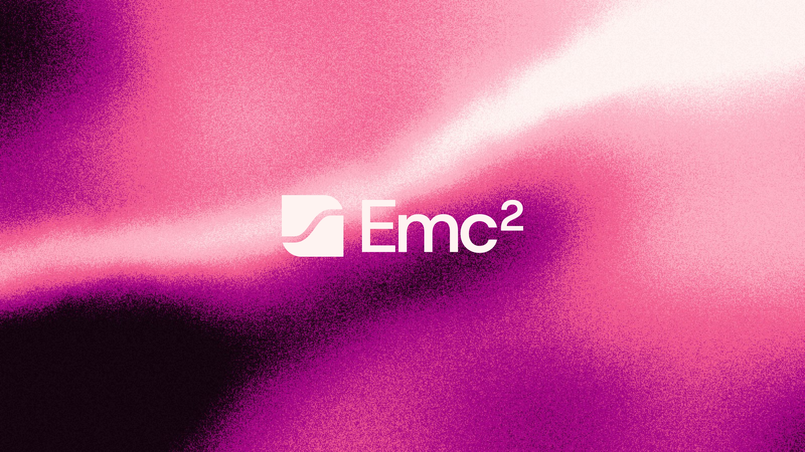

  

# Emc²

One inbox for every account, on Windows, macOS and Linux.

Emc² brings Gmail, iCloud, Fastmail, Yahoo and other IMAP accounts into one
desktop email client. Read, search and reply across accounts without switching
between mail apps. The installed app includes its runtime, so you do not need
a browser, terminal or separate Node installation.

[Download Emc²](https://github.com/collection-of-things/aggregate-mail/releases/latest)
· [Visit the website](https://emclient2.vercel.app)
· [Read the changelog](CHANGELOG.md)
· [Contribute](CONTRIBUTING.md)

## What you can do

- Read all your accounts in one inbox, with category tabs and account filters.
- Search cached mail and drafts, then save searches you use often.
- Archive, pin, snooze and select messages with the keyboard or mouse.
- Write replies with templates and signatures, use Undo send, or schedule a send.
- Import contacts, review unsubscribe destinations and keep local calendar events.
- Add AI sorting or connect an AI client through scoped MCP permissions when you choose.

## Get started

1. [Download the latest release](https://github.com/collection-of-things/aggregate-mail/releases/latest)
   for your system and [install it](docs/install.md#install).
2. Open Emc² and [connect an account](docs/accounts.md#connect-an-account). The connection
   dialog guides you through Google sign-in or an app password.
3. Read and sort your mail. Local sorting works without an AI key; use Teach
   to make rules for a sender or group of messages.

## Your mail and optional AI

Emc² stores cached mail and account credentials in an encrypted database on
your computer. It connects to your mail providers to sync and send messages.
Snoozes and saved views stay local to this client.

AI sorting is optional. When you enable it, the app sends the sender, subject
and a short message preview to your configured AI provider. MCP access is off
by default and requires explicit account and tool permissions. Sending needs
its own permission. See [local storage](docs/storage-and-backups.md#local-storage),
[AI sorting](docs/ai-and-agents.md#jev-sorting) and
[MCP](docs/ai-and-agents.md#mcp) for the details.

## Install

Download the [latest release](https://github.com/collection-of-things/aggregate-mail/releases/latest)
for your system. The installed app includes its runtime.

| System | Download | Open it |
| --- | --- | --- |
| Windows x64 | `.exe` setup installer | Run setup, then open Emc² from Start. |
| macOS, Apple silicon | `mac-arm64.dmg` | Drag Emc² into Applications, then open it there. |
| macOS, Intel | `mac-x64.dmg` | Drag Emc² into Applications, then open it there. |
| Linux x64 | `.AppImage` | Allow it to run as a program, then open it. |

Windows may show an unknown-publisher warning. macOS releases are ad-hoc
signed and not notarized, so macOS may block the first launch. See the
[installation guide](docs/install.md) for source builds, updates and platform details.

<!-- Keep existing README section links working after the guide split. -->

## Guides

Pick the guide for what you want to do.

| Guide | What it covers |
| --- | --- |
| [Accounts](docs/accounts.md) | Google sign-in, app passwords, custom IMAP and sync recovery. |
| [Using your inbox](docs/mail-guide.md) | Search, saved views, compose, contacts, unsubscribe review and shortcuts. |
| [Browser and phone access](docs/browser-access.md) | Local hosting, profile protection, Tailscale and passkey pairing. |
| [AI sorting and agents](docs/ai-and-agents.md) | Optional Jev sorting, MCP permissions and draft review. |
| [Storage and backups](docs/storage-and-backups.md) | Encryption, local data, backup contents and restore limits. |
| [Command line](docs/cli.md) | Connect the CLI to the running app with scoped permissions. |

## Build and contribute

Start with [Contributing](CONTRIBUTING.md) for setup and required checks.
The [development guide](docs/development.md) covers source commands,
packaging and verification. See [releases](CONTRIBUTING.md#ci-and-releases)
for publishing rules and [the changelog](CHANGELOG.md) for changes.

Report problems through [Issues](https://github.com/collection-of-things/aggregate-mail/issues).
Use [the security policy](SECURITY.md) for vulnerabilities.

## License

Emc² is available under the [MIT license](LICENSE).
